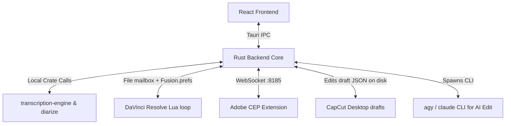

# 🤖 Agent's Lay of the Land (AGENTS.md)

> **Note:** This document is primarily intended for AI agents working on the AutoSubs codebase. For general documentation, see the [main README](README.md), [Contributing Guide](CONTRIBUTING.md), or [AutoSubs-App README](AutoSubs-App/README.md).

AutoSubs is a local-first desktop application that generates accurate, timestamped, and speaker-labeled subtitles from audio or video files. It runs standalone or integrates directly with video editors (DaVinci Resolve, Adobe Premiere Pro/After Effects, and CapCut Desktop) using local bridges.

---

## 🧭 System Topology & Bridge Ports

AutoSubs uses a local-first **Tauri v2 (Rust + React)** app communicating with host editors via dedicated loopback bridges:



---

## ⚠️ High-Context & Tricky Architecture Details

### 1. The DaVinci Resolve Bridge (File Mailbox)
* **The Gotcha**: Resolve 21.1 sandboxes the Lua state that runs Workspace > Scripts: `io`, `ffi`, `package`, `require`, `os.execute` and `bmd.readdir` are all nil. The old `ljsocket` HTTP server on port `56002` can no longer exist.
* **The Transport**: Rust writes `request.lua` into a mailbox directory (`<data_local_dir>/com.autosubs/resolve-bridge`); the Lua loop reads it with `loadfile` and answers through `fusion:SetPrefs` + `SavePrefs()`, which Rust polls in `Fusion.prefs`. One request at a time. See [resolve_bridge.rs](AutoSubs-App/src-tauri/src/resolve_bridge.rs).
* **Lua side**: [bootstrap.lua](AutoSubs-App/src-tauri/resources/modules/bootstrap.lua) replaces `require` with a `loadfile`-based loader and starts the loop; [autosubs_core.lua](AutoSubs-App/src-tauri/resources/modules/autosubs_core.lua) holds the handlers.
* **Launcher install**: [AutoSubs.lua](AutoSubs-App/src-tauri/resources/AutoSubs.lua) is a template; release builds write the real launcher into Resolve's Scripts folder on startup ([resolve_scripts.rs](AutoSubs-App/src-tauri/src/resolve_scripts.rs)). Dev uses `npm run setup-resolve`.
* **Port `56002`** is now only a Rust-side HTTP compat proxy (`init_http_compat_proxy`) so the Python shim in `resources/autoedit-shim` keeps working.
* The frontend never touches the mailbox directly; everything goes through the `resolve_bridge` Tauri command.
* **Documentation**: Comprehensive documentation of the Resolve integration architecture, Lua server API, Fusion macro system, and development workflow is available in [Resolve-Integration/README.md](Resolve-Integration/README.md).

### 2. Local AI Execution & Cargo Features
* **Engines**: Transcription is handled by `whisper-rs` (C++ bindings) and `transcribe-rs` (ONNX via `ort` for Moonshine/Parakeet). Diarization is a custom Pyannote port in Rust ([diarize](AutoSubs-App/src-tauri/crates/diarize)).
* **Platform Features**: Acceleration requires explicit Cargo features during compile-time:
  * **macOS (Apple Silicon)**: `--features mac-aarch` (Metal + CoreML).
  * **Windows**: `--features windows` (Vulkan + DirectML).
  * **Linux**: `--features linux` (Vulkan).
* **How to Run/Build**: Dev and build commands inside `AutoSubs-App/` pass these flags automatically:
  * **Unified Dev Mode**: `npm run dev` (cross-platform OS & architecture detector).
  * **Targeted Dev Mode**: `npm run dev:mac:arm64`, `npm run dev:mac:x86_64`, `npm run dev:win`, or `npm run dev:linux`.
  * **Build Production**: `npm run build:mac:arm64` (Mac ARM), `npm run build:mac:x86_64` (Mac Intel), `npm run build:win` (Windows), or `npm run build:linux` (Linux).


### 3. DaVinci Resolve Sandboxing & Non-ASCII Paths (Windows)
* With no `io` or `ffi`, Lua cannot open files itself; it only uses `loadfile` and Fusion prefs.
* On Windows, `LOCALAPPDATA` is mangled when the profile name isn't representable in the ANSI code page, so the app substitutes an ANSI-safe mailbox path into the launcher (`__AUTOSUBS_MAILBOX_DIR__`) instead of letting Lua rebuild it.
* **Fusion Macro**: The animated caption macro is stored at [Resolve-Integration/autosubs-macro.setting](Resolve-Integration/autosubs-macro.setting). See [Resolve-Integration/README.md](Resolve-Integration/README.md) for editing instructions and workflow.

### 4. Adobe CEP WebSocket Bridge (Port `8185`)
* Communicates with Adobe Premiere Pro and After Effects through the bundled CEP extension ([Adobe-Extension](Adobe-Extension)).
* **Tricky Detail**: The extension launches a WebSocket client connecting to the Tauri app's built-in server ([adobe_bridge.rs](AutoSubs-App/src-tauri/src/adobe_bridge.rs)) to coordinate timeline audio exports and subtitle imports.
* **Documentation**: The Adobe extension has excellent documentation at [Adobe-Extension/README.md](Adobe-Extension/README.md).

### 4b. CapCut Desktop Bridge (No Network)
* CapCut has no scripting API. The app reads and writes project folders under `com.lveditor.draft/` directly ([capcut/](AutoSubs-App/src-tauri/src/capcut)). Times are in microseconds.
* After a write, the project must be reopened from CapCut Home to show the changes.

### 4c. AI Edit (CLI Chat + MCP)
* The AI Edit tab drives a local `agy` or `claude` CLI as a subprocess ([ai_cli/](AutoSubs-App/src-tauri/src/ai_cli)), with a per-project workspace from `ai_cli/workspace.rs`. Each conversation is bound to one editor; its system prompt comes from [aiedit/prompts/](AutoSubs-App/src/components/aiedit/prompts), one file per editor plus `shared.ts`. Everything else editor-specific on the frontend (backend target, bound project, snapshot, refresh after an edit) is an adapter in [aiedit/editors/](AutoSubs-App/src/components/aiedit/editors), so `use-ai-edit-controller.ts` has no per-editor branches.
* Timeline edits (`build_storyboard`, `add_marker`, `add_text`, `update_segment`, `delete_segment`, `split_clips`, `remove_ranges`) are parsed and validated in [ai_edit/actions.rs](AutoSubs-App/src-tauri/src/ai_edit/actions.rs), which dispatches on `Editor` to one backend per editor in [ai_edit/editors/](AutoSubs-App/src-tauri/src/ai_edit/editors): `davinci.rs` calls the Lua endpoints in [ai_edit.lua](AutoSubs-App/src-tauri/resources/modules/ai_edit.lua), `capcut.rs` edits the draft JSON, `premiere.rs` sends `request_ai_edit` over the CEP bridge (`adobe_bridge::request`, which waits for the reply by sessionId) to `aiEdit` in [ppro/ai-edit.ts](Adobe-Extension/src/jsx/ppro/ai-edit.ts); its media placement is `ppro/ai-edit-storyboard.ts`, a separate copy of the Slideshow tab's `buildStoryboard` so the two evolve independently. Each backend also declares its MCP tool schemas (`edit_tools()`). An editor with no backend (After Effects) is rejected, never routed to Resolve. Adding one: a new `editors/<name>.rs`, an `Editor` variant, its arms in `actions.rs` and `mcp/tools.rs`, and a `prompts/<name>.ts`.
* **Cuts per editor**: Resolve has no razor/move API, so split, cut, move and retime rebuild the clip (delete it, `AppendToTimeline` the pieces from its media pool item, copy the transform back); grades and Fusion effects are lost and speed-changed clips are refused. Premiere razors through the QE DOM (`createRazor` in `ppro/ai-edit-util.ts` checks the cut landed) and ripples by moving clips; CapCut cuts the draft JSON in [capcut/cut.rs](AutoSubs-App/src-tauri/src/capcut/cut.rs).
* **`get_transcript`** ([ai_edit/transcript.rs](AutoSubs-App/src-tauri/src/ai_edit/transcript.rs)) is a read tool in both modes: it reads the saved transcripts in `<app local data>/Transcripts`, defaulting to the one open in the app (`EditTarget.transcriptFile`, sent by the controller), else the newest.
* **Download tools** ([ai_edit/media.rs](AutoSubs-App/src-tauri/src/ai_edit/media.rs)): `inspect_media`, `download_media` and `save_article` run the Download tab's own code and save into the run's project workspace (`ai-broll/`, `articles/`). The session carries that workspace (`open_session(.., workspace)` from `ai_cli/chat.rs`); the tools are listed only when it is set, and work in Manual runs too.
* **Turbo** runs give the agent an MCP server ([ai_edit/mcp/server.rs](AutoSubs-App/src-tauri/src/ai_edit/mcp/server.rs), schemas in `mcp/tools.rs`): 127.0.0.1, random port, per-run bearer token, one `/mcp/<session>` per run. Claude Code gets it via `--mcp-config`; `agy` only reads its own config, so the app runs `agy mcp add autosubs <url>` before each run. **Manual** runs get read-only tools and the agent writes ```timeline-action blocks the user applies.

### 4d. Download Tab (yt-dlp, Site Sessions, Articles)
* [media_download.rs](AutoSubs-App/src-tauri/src/media_download.rs) runs yt-dlp (installed on first use with Deno for YouTube's player JS). Runs on a known site get cookies from [site_session.rs](AutoSubs-App/src-tauri/src/site_session.rs): a hidden webview on its own cookie store loads YouTube/TikTok's home page for visitor cookies (without them YouTube answers 429 "confirm you're not a bot"), and a visible sign-in window per site (`site_session_login`) covers Instagram, Vimeo and private posts. A failure that a sign-in would fix comes back with `loginSite`, which the UI turns into a sign-in button.
* [article.rs](AutoSubs-App/src-tauri/src/article.rs) saves a web article as `article.md` plus `images/` by fetching and parsing the HTML (known body selectors of news sites first, then the element with the most paragraph text). No browser is opened, so JavaScript-built pages come back thin, which the result warns about.

### 5. Error Propagation Across the Boundary
* **The Gotcha**: Because transcription and diarization run fully locally across multiple sub-crates, native C/C++ exceptions and ONNX load errors can easily crash the backend.
* **The Rule**: All internal crate errors must bubble up explicitly as standard Rust `Result<T, String>` or `eyre::Result` types, which Tauri command handlers serialize into rejected JS promises so the React UI can gracefully display error dialogs.

### 6. UI Copy & Translations (i18n)

All user-facing strings live in `AutoSubs-App/src/i18n/locales/<lang>/translation.json` across **2 locales**: `en`, `vi`.

* **Never add an English-only key.** Every new key must land in every locale file in the same change, or the other locales silently fall back to the raw key. The same goes for deletions — when UI is removed, strip the orphaned keys from every locale.
* **Length is a hard constraint, and it applies per language.** Settings rows use `ItemDescription` ([item.tsx](AutoSubs-App/src/components/ui/item.tsx)), which combines `text-balance` with `line-clamp-*`. Two failure modes follow:
  * Past roughly **60 characters** the row wraps, and because of `text-balance` it does *not* fill the first line — it splits into two evenly-sized short lines, which looks broken rather than merely long.
  * Past the `line-clamp` limit the text is silently truncated with an ellipsis, losing information entirely.
* **Budget**: descriptions ≤ **60 characters**, titles ≤ **25 characters** — measured in *every* locale, not just English.
* **Translate to fit, not literally.** `de`, `es`, `fr` and `ru` routinely run 20–30% longer than English, so a comfortable 50-char English string becomes a wrapping 65-char German one. Shorten the wording for those locales instead of preserving English sentence structure; a terser phrasing that fits beats a faithful one that wraps.
* **No em dashes (`—`) or en dashes (`–`) in UI strings.** Use a comma, a period, or parentheses.
* **Write for non-technical video editors.** Prefer the plain-language name over the technical one (the DTW toggle is labelled "Whisper Word Refinement", not "Dynamic Time Warping"). Jargon in a settings row is a bug.
* **When one string references another feature, use that locale's own title** for it, not the English name.
* **Edit all locale files with a script**, not one at a time — it is the only reliable way to keep them in sync. Preserve the existing format: 2-space indent, `ensure_ascii=False`, trailing newline.

Check the budget before considering the work done:

```bash
cd AutoSubs-App && python3 -c "
import json, glob
for f in sorted(glob.glob('src/i18n/locales/*/translation.json')):
    lang = f.split('/')[-2]
    def walk(o, p=''):
        if isinstance(o, dict):
            for k, v in o.items(): walk(v, f'{p}.{k}')
        elif isinstance(o, str):
            if len(o) > 60: print(f'{lang} {len(o):4} {p}')
            if '—' in o or '–' in o: print(f'{lang} DASH {p}')
    walk(json.load(open(f, encoding='utf-8')))
"
```

Long-form strings (dialog bodies, error messages, onboarding) legitimately exceed 60 characters — the budget applies to compact UI: settings rows, toggle descriptions, buttons, badges, and menu items.

---

## ⚡ Development Cheatsheet

Always install dependencies inside `AutoSubs-App/` and compile using these target-specific flags:

| Action | Working Directory | Command |
| :--- | :--- | :--- |
| **Run Dev Mode (Auto)** | `AutoSubs-App/` | `npm run dev` |
| **Run Dev (Linux/Win)** | `AutoSubs-App/` | `npm run dev:linux` / `npm run dev:win` |
| **Build Web Assets** | `AutoSubs-App/` | `npm run build:web` |
| **Build Adobe CEP** | `Adobe-Extension/` | `npm run build` |

---

## Related Documentation

- **[Main README](README.md)** - Installation and general usage
- **[Contributing Guide](CONTRIBUTING.md)** - Development setup and contribution workflow
- **[AutoSubs-App README](AutoSubs-App/README.md)** - Technical architecture and code organization
- **[CLI Guide](CLI.md)** - Command-line interface reference
- **[Resolve Integration](Resolve-Integration/README.md)** - DaVinci Resolve integration architecture and development
- **[Adobe Extension](Adobe-Extension/README.md)** - Adobe Premiere Pro/After Effects integration details
